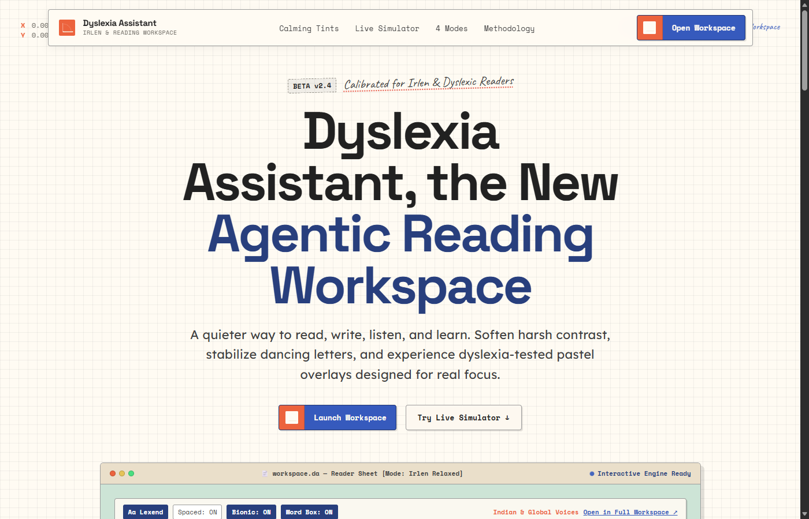
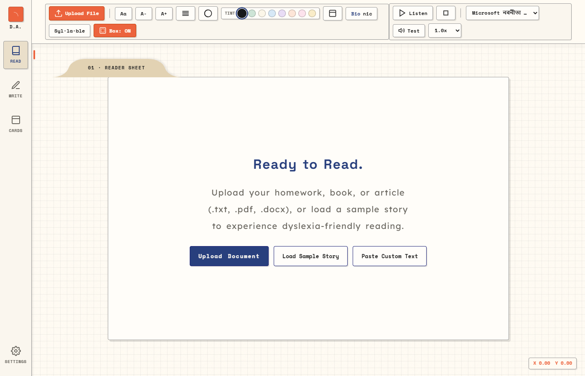
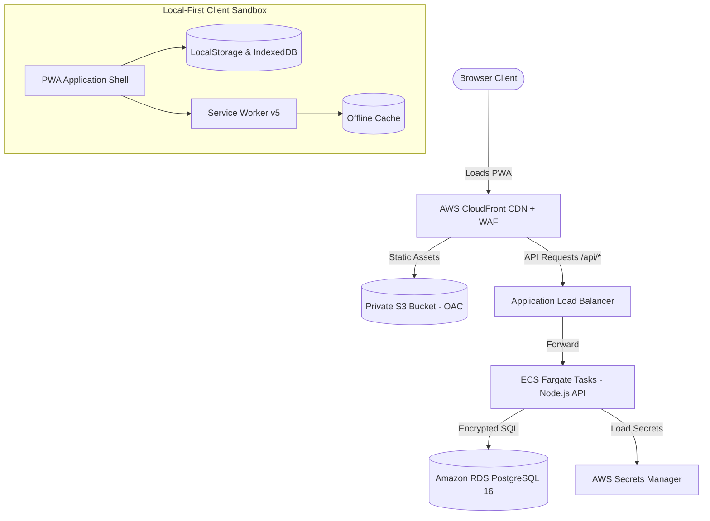

<div align="center">

# 📖 Dyslexia Assistant

### *A local-first, neurodivergent-tailored reading, writing, and cognitive learning workspace with production AWS DevOps engineering.*

[](LICENSE)
[](https://vitejs.dev/)
[](https://reactjs.org/)
[](sw.js)
[](#-accessibility--quality)
[](#-privacy--local-first-architecture)
[](SECURITY.md)

<br />

<p align="center">
  <a href="#-overview">Overview</a> •
  <a href="#-key-features">Key Features</a> •
  <a href="#-visual-tour">Visual Tour</a> •
  <a href="#-reading-tints">Reading Tints</a> •
  <a href="#-keyboard-shortcuts">Shortcuts</a> •
  <a href="#-architecture">Architecture</a> •
  <a href="#-devops--aws-infrastructure">DevOps & AWS</a> •
  <a href="#-security-compliance">Security</a> •
  <a href="#-getting-started">Getting Started</a>
</p>

</div>

---

## 🌟 Overview

**Dyslexia Assistant** is an all-in-one assistive cognitive workspace designed for individuals navigating dyslexia, visual reading fatigue, and focus challenges.

Reading on modern screens can lead to ocular strain, stark glare, character vibration, and phonological decoding hurdles. Dyslexia Assistant reduces these friction points through ergonomic typographic adjustments, customizable spectral color tints, synchronized word-boundary auditory tracking, phonetic writing support, and spaced-repetition flashcards.

### Product Principles
1. **Local-First Core**: Documents, drafts, flashcards, and preferences stay in the browser. Reading, writing, and flashcard practice work 100% offline.
2. **Accounts & Sync are Optional**: The server exists only for users who explicitly choose multi-device synchronization.
3. **Accessibility by Design**: Dyslexia-friendly typography, visible focus rings, ARIA landmarks, and high-contrast modes verified with automated `axe-core` tests.
4. **Evidence-Based Neutral Wording**: No unverified medical or clinical claims. Customizable reading comfort preferences tailored for individual visual rest.
5. **No Custom Cryptography**: Vetted Node.js crypto primitives, standard PostgreSQL relational models, and constant-time equality checks.

---

## 📸 Visual Tour

<div align="center">

| **Interactive Architectural Showcase** | **Assistive Cognitive Workspace** |
|:---:|:---:|
|  |  |
| *Real-time typography simulator & spectral swatch picker* | *Document parser, speech tracking, and reading ruler* |

</div>

---

## ✨ Key Features

### 1. 📖 Cognitive Reader Studio
* **Multi-Format Document Parsing**: Drag-and-drop or load **PDF** (`pdf.js`), Word **DOCX** (`mammoth.js`), and plain **TXT** files directly in-browser up to 10 MB. All parsers are vendored locally for offline use.
* **Ergonomic Typography Suite**:
  * Font cycling: **OpenDyslexic** (weighted bottoms prevent flipping), **Lexend** (empirically designed for reading flow), and **System Sans**.
  * Granular controls for font size, letter spacing, line height, and word spacing.
* **Bionic Reading Fixation**: Guides eye saccades and reduces fixation fatigue.
* **Syllable Breakdown**: Instant phonetic syllable division with hyphenated bullet markers.
* **Reading Rulers**:
  * **Focus Mask**: Shrouds surrounding text to isolate the active reading passage.
  * **Reading Line Guide**: Cursor-following guide to maintain horizontal tracking.
* **Word Lookup & Pronunciation**: Click any word to inspect syllables, letter count, hear audio pronunciation, and tap **"+ Add to Flashcards"**.
* **Session Persistence**: Restores the last active document automatically upon reload.

### 2. 🎙️ Synchronized Speech-to-Text & Focus Box
* **Precision Word-Boundary Tracking**: Built on the native Web Speech API with sub-millisecond audio-visual synchronization.
* **Word Tracking Focus Box**: High-visibility bounding box that highlights each spoken token in real-time.
* **Intelligent Auto-Scroll**: Locks reading focus dynamically across lengthy documents.
* **Speed & Voice Control**: Fluid speed adjustments ($0.5\times$ to $2.0\times$) with pitch controls.

### 3. ✍️ Distraction-Free Writer & Dictation Studio
* **Speech Dictation**: Dictate ideas hands-free using device speech recognition with graceful fallback messaging.
* **Heuristic Spelling Assistance**: Sound-alike spelling suggestions designed for common dyslexic confusions (`frend` → `friend`, `teh` → `the`).
* **Live Readability Statistics**:
  * **Flesch-Kincaid Grade Level** computation.
  * **Flesch Reading Ease** score.
  * Live word count, character count, and estimated reading time.
* **Export & Auto-Drafting**: Automatically autosaves drafts locally; export anytime to `.txt`.

### 4. 🧠 Spaced Repetition System (SRS) Flashcards
* **7-Interval Spaced Repetition Algorithm**:
  Cards progress through 7 documented intervals based on memory recall:
  
  | Level | Interval Window | Recall Timing |
  |:---:|:---:|:---|
  | **0** | $1\text{ minute}$ | Immediate re-test |
  | **1** | $10\text{ minutes}$ | Short-term acquisition |
  | **2** | $60\text{ minutes}$ | 1-hour checkpoint |
  | **3** | $240\text{ minutes}$ | 4-hour checkpoint |
  | **4** | $1,440\text{ minutes}$ | 24-hour retention |
  | **5** | $4,320\text{ minutes}$ | 3-day retention |
  | **6** | $10,080\text{ minutes}$ | 1-week mastery |

* **Rating Actions**:
  * **Again**: Resets to Level 0 (1 minute).
  * **Hard**: Steps back 1 level (floor at Level 0).
  * **Good**: Advances 1 level (cap at Level 6).
  * **Easy**: Jumps 2 levels forward (cap at Level 6).
* **Dyslexia Starter Deck**: Pre-loaded with tricky letter pairs (`b` vs `d`, `p` vs `q`, `was` vs `saw`) and confusing homophones.
* **Keyboard-Driven Study Mode**: `Space` (flip card), `1` (Again), `2` (Hard), `3` (Good), `4` (Easy).

---

## 🎨 Reading Comfort Tints

Customizable background tints allow users to reduce stark monitor glare:

| Tint Name | Swatch | Color Hex | Visual Purpose |
|:---|:---:|:---:|:---|
| **Sage Green** | 🟢 | `#CDE4D6` | Calming green tone that softens high-contrast glare. |
| **Soft Cream** | 🟡 | `#FBF6E8` | Warm parchment sepia that relieves harsh monitor reflection. |
| **Sky Blue** | 🔵 | `#CFE0EF` | Soothing cool tone that helps steady letter tracking. |
| **Lavender** | 🟣 | `#DFCEEF` | Gentle violet tone providing ocular visual rest. |
| **Soft Peach** | 🟠 | `#EBD3C8` | Warm comfort tint that softens character edges. |
| **Soft Rose** | 🌸 | `#ECD3DE` | Comfort tint for sensitive eyes under bright room lighting. |
| **Warm Amber** | 🟤 | `#F9ECC8` | Gentle warmth for evening and low-light reading. |
| **Midnight Dark** | ⚫ | `#16181B` | High-contrast dark background for reduced overall luminance. |

---

## ⌨️ Accessibility & Shortcuts

* Fully audited with `@axe-core/playwright` ensuring **zero serious or critical WCAG 2.1 AA violations**.
* Respects `prefers-reduced-motion` and `prefers-color-scheme`.

| Shortcut | Action |
|:---|:---|
| <kbd>Alt</kbd> + <kbd>1</kbd> | Switch to **Reader Workspace** |
| <kbd>Alt</kbd> + <kbd>2</kbd> | Switch to **Writer Studio** |
| <kbd>Alt</kbd> + <kbd>3</kbd> | Switch to **Flashcard Vault** |
| <kbd>Space</kbd> | Play / Pause Speech (Reader) or Flip Flashcard (Study Mode) |
| <kbd>Escape</kbd> | Close word lookup card or settings modal |
| <kbd>1</kbd> / <kbd>2</kbd> / <kbd>3</kbd> / <kbd>4</kbd> | Rate flashcard: Again / Hard / Good / Easy |

---

## 🏗️ Architecture & Tech Stack



### Technology Highlights
* **Client App**: Vanilla ES6+ modules (`js/`), custom Plamo architectural design system (`css/styles.css`).
* **Landing Page**: React 19.3 & Vite 8.3.
* **Offline PWA**: Versioned Service Worker (`sw.js`) caching all local application shell assets, fonts, and parsers.
* **Backend API**: Node.js REST API with input validation schemas, rate limiting, and scrypt password hashing.
* **Database**: PostgreSQL 16 with idempotent schema migrations (`server/schema.sql`) and transparent in-memory fallback.

---

## ☁️ DevOps & AWS Infrastructure

This repository is equipped with a complete, production-grade DevOps toolchain targeting **Amazon Web Services (AWS)**:

### 1. Multi-Stage Containerization
* **`Dockerfile.api`**: Multi-stage Alpine container, non-root `node` user, built-in healthchecks, production dependency caching.
* **`Dockerfile.web`**: Multi-stage build compiling Vite assets, served via `nginxinc/nginx-unprivileged:1.27-alpine` on port 8080 with strict security headers and reverse proxying.
* **`docker-compose.yml`**: Local production parity orchestrator uniting `db` (Postgres 16), `api` (port 3001), and `web` (port 8080).

### 2. Infrastructure as Code (Terraform)
Modular Terraform configurations located under `terraform/`:
* `modules/networking/`: 2-AZ VPC, public/private/database subnets, NAT Gateways.
* `modules/security/`: KMS Customer Managed Keys, least-privilege Security Groups.
* `modules/database/`: RDS PostgreSQL instance with automated backups and KMS encryption.
* `modules/ecs_api/`: ECS Fargate cluster, task definitions loading secrets from Secrets Manager, ALB with healthchecks, and auto-scaling policies.
* `modules/frontend/`: Private S3 bucket, CloudFront Origin Access Control (OAC), Response Headers Policy, and AWS WAFv2 rate limiting.
* `modules/monitoring/`: CloudWatch dashboards, SNS alerting, and AWS Budget controls ($25 dev / $100 prod).
* `environments/dev/` & `environments/prod/`: Environment configurations with remote state locking.

### 3. CI/CD GitHub Actions Pipeline
* **PR Verification (`.github/workflows/pr-checks.yml`)**:
  - `npm audit` dependency vulnerability checks (fails on high/critical).
  - Gitleaks secret scanning.
  - Unit, integration, and SRS tests (`npm test`).
  - Playwright browser E2E and Axe-Core accessibility audits.
  - Hadolint Dockerfile linting and Trivy container vulnerability scanning.
  - Terraform formatting, validation, and Checkov security scanning.
* **Deployment Pipeline (`.github/workflows/deploy.yml`)**:
  - AWS OIDC authentication (no static AWS keys stored in GitHub).
  - Docker build & push to Amazon ECR tagged with Git commit SHA.
  - ECS task definition registration and zero-downtime rolling service deployment.
  - Automated smoke test with automated rollback on healthcheck failure.
* **Automated Dependency Updates (`.github/dependabot.yml`)**:
  - Weekly checks for npm, Docker, GitHub Actions, and Terraform dependencies.

---

## 🛡️ Security Compliance (Secure Vibe Coding)

Dyslexia Assistant implements all 5 layers of the **Secure Vibe Coding** standard:

| Layer | Requirement | Implementation | Evidence & Tests |
|---|---|---|---|
| **Layer 01** | Strict Server Validation | `server/securityMiddleware.js` schema validator | `test/security.test.js`, rejects unknown write fields and malformed payloads |
| **Layer 02** | Rate Limit Sensitive Endpoints | IP & account rate limiter using socket address | `test/integration.test.js`, rotated `X-Forwarded-For` spoofing rejected |
| **Layer 03** | Purpose-Built Password Hashes | `crypto.scrypt` with 16-byte random salts | `test/security.test.js`, timing-safe comparisons, unique salts |
| **Layer 04** | Error Sanitization | Centralized production error handler | `test/security.test.js`, strips stack traces and internal paths in prod |
| **Layer 05** | Secure Session Cookies | 32-byte tokens with `HttpOnly`, `SameSite=Strict` | `test/integration.test.js`, CSRF custom header check, server logout revocation |
| **Step 04** | IDOR Ownership Checks | Database-backed ownership verification | `test/integration.test.js`, cross-user isolation returns 403 |
| **Step 05** | Security Headers | CSP, `nosniff`, `frame-ancestors 'none'` | `scripts/security-review.js`, CloudFront & NGINX headers |

Run the automated security verification suite anytime:
```bash
node scripts/security-review.js
```

---

## 🚀 Getting Started

### Local Quickstart

1. **Clone the repository**:
   ```bash
   git clone https://github.com/anshu706/Dyslexia-Assistant.git
   cd Dyslexia-Assistant
   ```
2. **Install dependencies**:
   ```bash
   npm install
   ```
3. **Run tests**:
   ```bash
   npm test                 # Run 20 unit, integration, and security tests
   npx playwright test      # Run 12 browser E2E and Axe-Core tests
   node scripts/security-review.js # Run automated security audit
   ```
4. **Start local development server**:
   ```bash
   npm run dev              # Starts frontend dev server
   npm run server           # Starts backend API on port 3001
   ```

### Running with Docker Compose

To test the entire containerized architecture locally (Postgres 16, API, and NGINX):
```bash
docker-compose up --build
```
Navigate to `http://localhost:8080` to access the full application through NGINX with backend API routing.

---

## 📜 Documentation Directory

Detailed engineering artifacts are maintained under `docs/`:
- [`docs/adr/`](docs/adr/): Architecture Decision Records (Hosting, Auth, Database, Password Hashing, Offline PWA).
- [`docs/slo.md`](docs/slo.md): Service Level Objectives & Reliability Targets.
- [`docs/cost.md`](docs/cost.md): AWS Monthly Cost Breakdown & Budget Controls.
- [`docs/runbook.md`](docs/runbook.md): Deployment, Rollback, Secret Rotation, and Incident Runbooks.
- [`docs/security-review.md`](docs/security-review.md): Full Secure Vibe Coding Compliance Matrix.
- [`SECURITY.md`](SECURITY.md): Vulnerability Disclosure Policy & Threat Model.

---

## 📜 License

This project is open-source and licensed under the [MIT License](LICENSE).
