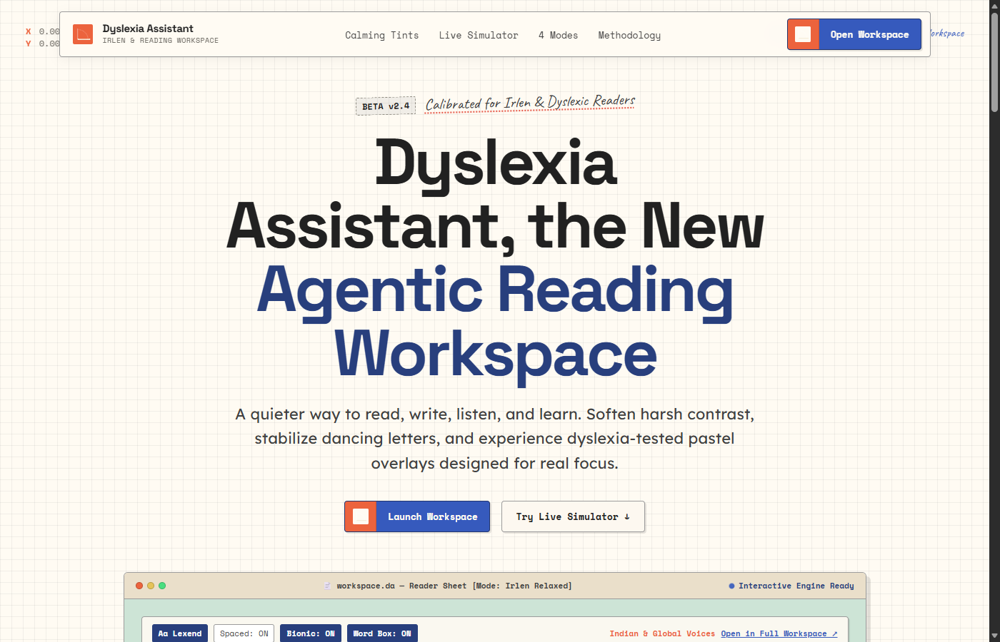
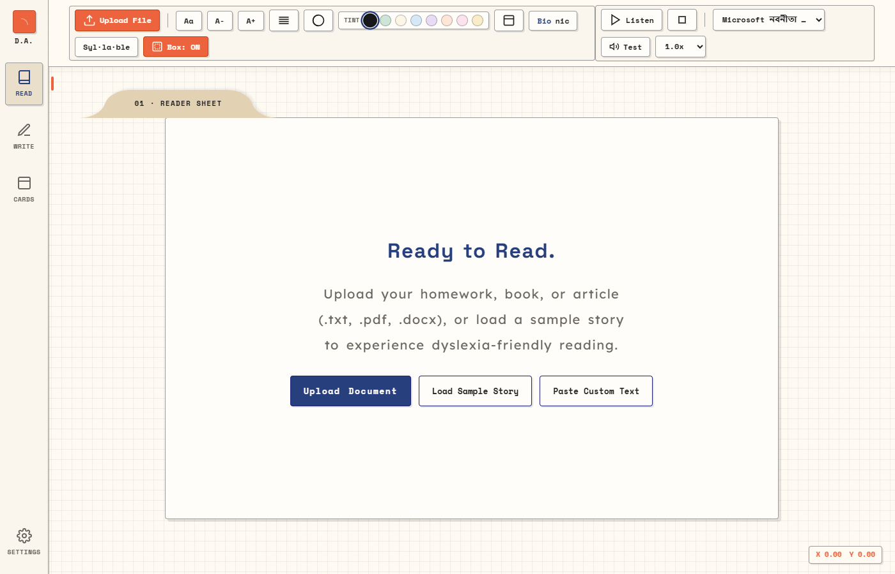
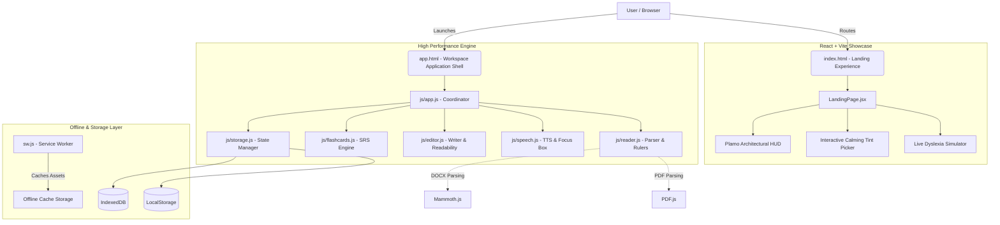

<div align="center">

# 📖 Dyslexia Assistant

### *An offline-first, neurodivergent-tailored reading, writing, and cognitive learning workspace.*

[](LICENSE)
[](https://vitejs.dev/)
[](https://reactjs.org/)
[](sw.js)
[](#-accessibility--keyboard-shortcuts)
[](#-privacy--offline-architecture)
[](SECURITY.md)

<br />

<p align="center">
  <a href="#-overview">Overview</a> •
  <a href="#-key-features">Key Features</a> •
  <a href="#-visual-tour">Visual Tour</a> •
  <a href="#-clinical-tint-science">Tint Science</a> •
  <a href="#-keyboard-shortcuts">Shortcuts</a> •
  <a href="#-architecture">Architecture</a> •
  <a href="#-security--secure-vibe-coding-compliance">Security</a> •
  <a href="#-getting-started">Getting Started</a>
</p>


---

## 📹 Video Showcase

> Experience the tint overlays, bionic reading, synchronized speech, and spaced-repetition flashcards of **Dyslexia Assistant** in action.

<div align="center">

### 🎬 Full Demo Walkthrough

<video src="https://github.com/user-attachments/assets/3a002dfb-2c0a-4ce2-83eb-b724d370e15d" controls="controls" muted="muted" width="100%" style="max-height: 600px; border-radius: 12px; box-shadow: 0 20px 40px rgba(0,0,0,0.25);">
  <p>Your browser does not support HTML5 video. <a href="https://github.com/user-attachments/assets/3a002dfb-2c0a-4ce2-83eb-b724d370e15d"><b>Click here to view or download the demo video</b></a>.</p>
</video>

</div>


<br />

## 🌟 Overview

**Dyslexia Assistant** is an all-in-one assistive cognitive workspace crafted specifically for individuals navigating **Dyslexia**, **Irlen Syndrome** (Scotopic Sensitivity), **ADHD**, and visual stress conditions.

Reading on modern screens can be an exhausting battle against stark contrast, ocular fatigue, character vibration, and phonological decoding hurdles. Dyslexia Assistant dissolves these friction points through a thoughtfully engineered suite of typographic controls, spectral tint overlays, synchronized auditory tracking, phonetic writing support, and spaced-repetition flashcards.

### Why Dyslexia Assistant?

* 🎯 **Zero Stark White Glare**: 8 clinically formulated Irlen tint overlays that stabilize visual jitter.
* 🔡 **Specialized Neuro-Typographies**: Built-in OpenDyslexic, Lexend, and customizable glyph spacing.
* ⚡ **Bionic & Syllabic Decoding**: Micro-fixation bolding and hyphenated phonetic breakdowns.
* 🗣️ **Synchronized Audio & Focus Box**: Word-boundary highlighting with real-time viewport tracking.
* 🛡️ **100% Private & Offline-First**: Zero tracking, zero cloud telemetry, instant PWA caching.

---

## 📸 Visual Tour

<div align="center">

| **Interactive Architectural Landing** | **Assistive Cognitive Reader** |
|:---:|:---:|
|  |  |
| *Real-time dyslexia simulator & spectral swatch picker* | *Document parser, speech tracking, and reading ruler* |

</div>

---

## ✨ Key Features

### 1. 📖 Cognitive Reader Studio
* **Multi-Format Document Parsing**: Drag-and-drop or load **PDF** (`pdf.js`), Word **DOCX** (`mammoth.js`), and plain **TXT** files directly in-browser up to 10 MB.
* **Ergonomic Typography Suite**:
  * Seamless font cycling: **OpenDyslexic** (weighted bottoms prevent flipping), **Lexend** (empirically designed for reading speed), and clean **System UI**.
  * Granular controls for font size, letter spacing, line height, and word spacing.
* **Bionic Fixation Reading**: Automatically bolds initial syllables across words to guide eye saccades and reduce fixation fatigue.
* **Phonetic Syllable Segmentation**: Instant toggle to split multi-syllable terms with clean hyphens for easier phonetic decoding.
* **Dynamic Reading Rulers**:
  * **Focus Mask**: Shrouds surrounding text with adjustable opacity, isolating the active reading passage.
  * **Reading Line Guide**: Smooth laser guide that hugs cursor movement to anchor horizontal tracking.
* **One-Click Word Intelligence**: Click any word to trigger an instant Wikipedia definition modal with a 1-tap **"Add to Flashcards"** pipeline.

---

### 2. 🎙️ Synchronized Speech-to-Text & Focus Engine
* **Precision Word-Boundary Tracking**: Powered by the Web Speech API with sub-millisecond audio-visual synchronization.
* **Magnified Word Focus Box**: An elevated, high-contrast HUD highlighting the exact spoken token in real-time.
* **Intelligent Viewport Auto-Scroll**: Locks reading focus dynamically so you never lose your place across long texts.
* **Inclusive Voice Library**: Prioritizes natural Indian English (`en-IN`) voices alongside global regional accents, equipped with fluid speed ($0.5\times$ to $2.0\times$) and pitch adjusters.

---

### 3. ✍️ Distraction-Free Writer & Dictation Studio
* **Speech-to-Type Voice Dictation**: Dictate ideas effortlessly without worrying about keyboard mechanics.
* **Phonetic Spell-Check**: Heuristic spelling suggestions tailored for sound-alike dyslexic patterns rather than strict orthography.
* **Real-Time Readability Intelligence**:
  * Live **Flesch-Kincaid Grade Level** computation.
  * **Flesch Reading Ease** scoring.
  * Live word count, sentence count, and estimated reading time.
* **Clean Text Export**: Save work instantaneously as clean `.txt` files or rely on automatic local session persistence.

---

### 4. 🧠 Spaced Repetition System (SRS) Flashcard Vault
* **Tactile 3D Cards**: Flip animations with tactile ease-of-use.
* **Dyslexia Starter Deck (12 Curated Cards)**:
  * Mirror orientation drills: `b` vs `d`, `p` vs `q`, `was` vs `saw`.
  * Phonetic traps: `their` / `there` / `they're`, silent letters (`know`, `write`, `thumb`).
  * Tricky spelling mnemonics: `because` (*Big Elephants Can Always Use Small Eggs*), `friend`, `definitely`.
  * Digraph rules: `ei` vs `ie` rule and vowel variants.
* **Leitner / SuperMemo Algorithm**: Categorizes cards across 5 review intervals (1 day, 3 days, 1 week, 2 weeks, 1 month).
* **Keyboard-Driven Study Mode**: Rapid study sessions using `Space` (flip) and numerical ratings (`1` Again, `2` Hard, `3` Good).

---

## 🎨 Clinical Tint Science (Irlen Syndrome Relief)

Irlen Syndrome is a perceptual processing disorder where specific wavelengths of light create visual distortion. Dyslexia Assistant incorporates 8 carefully calibrated ambient spectral palettes:

| Tint Name | Swatch | Color Hex | Clinical Purpose & Symptom Relief |
|:---|:---:|:---:|:---|
| **Sage Green** | 🟢 | `#CDE4D6` | Dramatically reduces high-contrast glare, ocular strain, and page distortion. |
| **Soft Cream** | 🟡 | `#FBF6E8` | Natural parchment tone that eliminates stark white reflection and eases long reading blocks. |
| **Sky Blue** | 🔵 | `#CFE0EF` | Stabilizes perceptual letter movement, word floating, and text vibration. |
| **Lavender** | 🟣 | `#DFCEEF` | Calms visual cortex hyperexcitability and alleviates perceptual stress. |
| **Soft Peach** | 🟠 | `#EBD3C8` | Warm spectral wavelength that sharpens character boundaries without harshness. |
| **Soft Rose** | 🌸 | `#ECD3DE` | Soothes photosensitivity and softens harsh fluorescent / LED backlights. |
| **Warm Amber** | 🟤 | `#F9ECC8` | Golden amber glow that alleviates late-night reading fatigue and blue-light strain. |
| **Midnight Dark** | ⚫ | `#16181B` | Deep restful dark ambient canvas with muted typography contrast. |

---

## ⌨️ Accessibility & Keyboard Shortcuts

Dyslexia Assistant conforms to **WCAG 2.1 AA** guidelines, featuring ARIA landmarks, `aria-live` announcer regions for screen readers, and full keyboard parity.

### Global Navigation
| Shortcut | Action |
|:---|:---|
| <kbd>Alt</kbd> + <kbd>1</kbd> | Jump to **Reader Workspace** |
| <kbd>Alt</kbd> + <kbd>2</kbd> | Jump to **Writer Studio** |
| <kbd>Alt</kbd> + <kbd>3</kbd> | Jump to **Flashcard Vault** |
| <kbd>Alt</kbd> + <kbd>4</kbd> | Open **Global Settings & High-Contrast Mode** |

### Reader & Audio Controls
| Shortcut | Action |
|:---|:---|
| <kbd>Space</kbd> | Play / Pause Text-to-Speech *(when not actively focused in an input)* |
| <kbd>Escape</kbd> | Close word lookup modal / Dismiss active overlays |

### Flashcard Study Mode
| Shortcut | Action |
|:---|:---|
| <kbd>Space</kbd> or <kbd>Enter</kbd> | Flip current flashcard |
| <kbd>1</kbd> | Rate as **Again** *(Reset SRS interval)* |
| <kbd>2</kbd> | Rate as **Hard** *(Slight SRS advancement)* |
| <kbd>3</kbd> | Rate as **Good** *(Standard SRS advancement)* |

---

## 🏗️ Architecture & Tech Stack

Dyslexia Assistant employs a lightweight, resilient hybrid architecture: an expressive **React + Vite** architectural landing experience coupled with a lightning-fast, zero-dependency **Modular Vanilla JavaScript** application shell.



### Core Technologies

* **Frontend Engine**: Vanilla ES6+ JavaScript, HTML5, Vanilla CSS3 (Custom Design System, Glassmorphic effects, Plamo architectural folder tabs).
* **Landing Framework**: [React 18](https://reactjs.org/) paired with [Vite](https://vitejs.dev/).
* **Audio & Speech**: Native Web Speech API (`SpeechSynthesis` & `webkitSpeechRecognition`).
* **Document Ingestion**: [PDF.js](https://mozilla.github.io/pdf.js/) & [Mammoth.js](https://github.com/mwilliamson/mammoth.js).
* **Typography**: Google Fonts ([Lexend](https://fonts.google.com/specimen/Lexend), [DM Sans](https://fonts.google.com/specimen/DM+Sans), [Space Grotesk](https://fonts.google.com/specimen/Space+Grotesk)) & [OpenDyslexic](https://opendyslexic.org/).
* **Offline PWA**: Native Service Worker (`sw.js`) with cache-first asset caching strategies.

---

## 🔒 Privacy & Offline Architecture

* **Zero Cloud Dependence**: All document parsing (PDF, Word, Text) is executed completely inside your browser client. No files are ever uploaded to an external server.
* **Private Voice Engine**: Text-to-speech and dictation utilize device-native speech synthesis engines.
* **Persistent Local Storage**: Flashcard decks, readability preferences, and editor drafts persist safely in your browser via `localStorage` and `IndexedDB`.
* **Full Offline Operation**: Install the PWA or disconnect from Wi-Fi anytime—all core features continue to run uninterrupted.

---

## 🛡️ Security & Secure Vibe Coding Compliance

Dyslexia Assistant incorporates the 5 security layers from the **Secure Vibe Coding** framework, ensuring both client sandbox safety and a production-grade server reference:

* **Layer 01 — Always Validate on the Server**: Client-side document checks (10 MB limit, strict `.txt`, `.pdf`, `.docx` MIME types, and 300,000 char bounds) backed by schema validation (`server/securityMiddleware.js`).
* **Layer 02 — Protect Login With Rate Limiting**: Anti-brute force sliding-window limiter on sensitive endpoints keyed by IP and account identifiers (`HTTP 429 Too Many Requests`).
* **Layer 03 — Never Store Passwords in Plain Text**: Purpose-built salted password hashing via `scrypt` / `Argon2id` with constant-time verification (`crypto.timingSafeEqual`) to eliminate timing attacks.
* **Layer 04 — Don't Leak Information Through Errors**: Unified `"Invalid email or password"` auth errors prevent account enumeration. Production error handling strips internal paths and stack traces.
* **Layer 05 — Don't Build Authentication From Scratch**: Cryptographic 32-byte session tokens with 24-hour expiration, delivered via `HttpOnly`, `Secure`, `SameSite=Strict` cookies.
* **Step 04 — Ownership Verification (IDOR)**: Multi-tenant authorization guards guaranteeing User A cannot read or modify User B's documents.
* **Step 05 — Production Security Headers**: Vite and server configs inject `X-Frame-Options: DENY`, `X-Content-Type-Options: nosniff`, `Referrer-Policy: strict-origin-when-cross-origin`, and `Permissions-Policy`.
* **Automated Security Verification**: Run `npm run test:security` to execute the full unit test suite.

> 📖 *For complete architecture documentation, threat models, and policy details, see [SECURITY.md](SECURITY.md).*

---

## 📁 Repository Structure

```plaintext
Dyslexia-Assistant/
├── 📄 index.html             # React + Vite architectural landing entry
├── 📄 app.html               # High-performance workspace shell
├── 📄 sw.js                  # PWA service worker (offline asset caching)
├── 📄 vite.config.js         # Multi-page build, static bundler & security headers
├── 📄 package.json           # Project manifest, dependencies & security test scripts
├── 📄 SECURITY.md            # Comprehensive Secure Vibe Coding audit & architecture
├── 📂 server/                # Secure Vibe Coding reference server & middleware
│   ├── 📄 securityMiddleware.js # Layer 01 validation, Layer 02 rate limiting, Layer 04 errors
│   ├── 📄 authService.js     # Layer 03 salted hashing, Layer 05 sessions & Step 04 IDOR
│   └── 📄 server.js          # Production-grade API server implementing the 5 layers
├── 📂 test/
│   └── 📄 security.test.js   # Automated unit test suite verifying all 5 security layers
├── 📂 src/
│   ├── 📄 main.jsx           # React root mount point
│   └── 📄 LandingPage.jsx    # Interactive simulator, story chapters & swatch HUD
├── 📂 js/
│   ├── 📄 security.js        # Input validation, safeStorage, prototype pollution defense
│   ├── 📄 app.js             # Global state coordinator & keyboard router
│   ├── 📄 reader.js          # Document parser, tints, bionic, syllables & ruler
│   ├── 📄 speech.js          # TTS with word-boundary highlight & focus box
│   ├── 📄 editor.js          # Writer studio, readability analyzer & spellcheck
│   ├── 📄 flashcards.js      # Spaced repetition system (SRS) & starter deck
│   ├── 📄 storage.js         # IndexedDB & LocalStorage sync
│   └── 📄 ui.js              # Theme manager, toast notifications & HUD
├── 📂 css/
│   ├── 📄 styles.css         # Plamo architectural design system & theme tokens
│   ├── 📄 accessibility.css  # High contrast rules, focus rings & ARIA aids
│   └── 📄 animations.css     # 3D card flips, transitions & ambient glow
└── 📂 public/                # Static distribution assets
```

---

## 🚀 Getting Started

### Prerequisites

Ensure you have [Node.js](https://nodejs.org/) (version `18.x` or higher) installed on your system.

### Installation

1. **Clone the repository**:
   ```bash
   git clone https://github.com/anshu706/Dyslexia-Assistant.git
   cd Dyslexia-Assistant
   ```

2. **Install dependencies**:
   ```bash
   npm install
   ```

3. **Start the local development server**:
   ```bash
   npm run dev
   ```

4. **Open your browser**:
   Navigate to `http://localhost:5173` to explore the landing page and launch into the workspace.

### Production Build

To compile and preview the optimized static build:

```bash
npm run build
npm run preview
```

The output in `dist/` is statically deployable to any hosting platform (Vercel, Netlify, GitHub Pages, or Cloudflare Pages) with full PWA capability.

---

## 🤝 Contributing

Contributions to make Dyslexia Assistant even more accessible, inclusive, and empowering are deeply welcomed!

1. **Fork the Repository**
2. **Create a Feature Branch**:
   ```bash
   git checkout -b feature/accessible-tint-enhancement
   ```
3. **Commit your changes**:
   ```bash
   git commit -m "feat: add high-legibility contrast tuning"
   ```
4. **Push to the branch**:
   ```bash
   git push origin feature/accessible-tint-enhancement
   ```
5. **Open a Pull Request**

---

## 📜 License

This project is open-source and licensed under the [MIT License](LICENSE).

---

<div align="center">

Made with care for accessible, frictionless learning for all minds.

⭐ If you find this project valuable, please consider giving it a star on GitHub!

</div>
